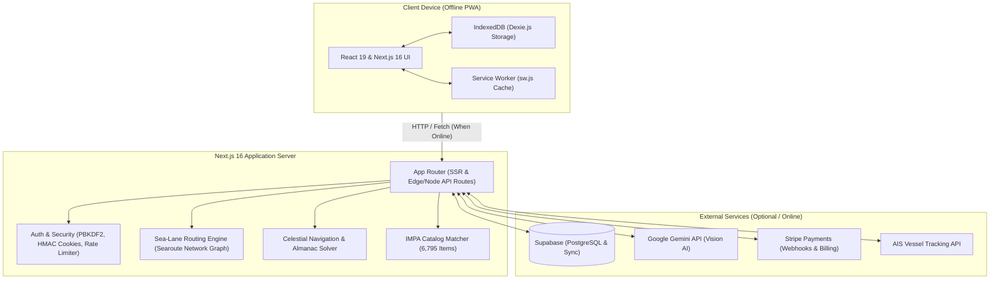

# Officer-Assistant (Shark) 🦈

> **Don't be the prey. Be the shark.** — An offline-ready maritime companion Progressive Web App (PWA) purpose-built for merchant navy officers, marine engineers, and shipboard crew.

[](https://nextjs.org/)
[](https://react.dev/)
[](https://www.typescriptlang.org/)
[](https://tailwindcss.com/)
[](https://web.dev/progressive-web-apps/)
[](LICENSE)

---

## 🌊 Overview

Operating in deep-sea environments presents unique challenges: zero satellite connectivity for weeks, intense regulatory audits (Port State Control, Flag State, OCIMF SIRE 2.0, USCG, Class), demanding watchkeeping schedules, and complex shipboard operations. 

**Officer-Assistant (Shark)** is an enterprise-grade maritime companion web application engineered to run **100% offline at sea** on personal smartphones, tablets, and shipboard laptops. From pre-arrival Port State Control readiness to celestial sight reduction, route planning with maritime chokepoints, official STCW exam preparation, and instant camera-based IMPA spare part recognition, Shark equips maritime professionals with an all-in-one operational toolkit.

### Built For:
- **Deck Officers & Bridge Teams**: Masters, Chief Mates, Officers of the Watch (OOW 2nd & 3rd Officers), and Deck Cadets.
- **Engine Officers & Technical Teams**: Chief Engineers, 2nd Engineers, OOW Engineers (3rd & 4th Engineers), and Electro-Technical Officers (ETO).
- **Shipboard Operations & Crew**: Bosuns, Pumpmen, Able Seafarers, Stewards, and Cooks.
- **Shore-side Operations**: Port Captains, Marine Superintendents, Technical Managers, and DPA (Designated Person Ashore) auditor teams.

---

## ⚓ Key Features

### 📋 1. Inspections & PSC Readiness
Comprehensive check-card engine designed to eliminate detentions, deficiencies, and audit observations before arrival.
- **~1,000 Inspection Check-Cards**: Fully structured cards across seven inspection regimes:
  - **Port State Control (PSC)**: Paris MoU, Tokyo MoU, USCG Foreign Vessel Inspection (Form 837).
  - **Flag State Inspections (FSI)**: Statutory requirements, safety equipment, crew documentation, and logs.
  - **SIRE 2.0**: The OCIMF Tanker Inspection regime (hardware, process, and human factors questions).
  - **CDI**: Chemical Distribution Institute inspection checklists.
  - **USCG**: United States Coast Guard boarding verification protocols.
  - **ISM & ISPS**: International Safety Management & Ship and Port Facility Security Code internal audits.
  - **Class Surveys**: Hull, machinery, electrical, Load Line, and MARPOL survey preparation.
- **Categorized Verification**: Clear guidance on *What to check*, *How to prepare*, *Required documentary evidence*, and *Regulatory reference* (SOLAS, MARPOL, STCW, MLC 2006, etc.).
- **Local Progress Tracking**: Mark items verified, add notes, and compute real-time readiness scores.

### 📝 2. SMS Marine Checklists
88 standardized Safety Management System (SMS) operational checklists and recurring watchkeeping tasks covering critical operations:
- **Bridge & Navigation**: Taking over navigational watch, departure/arrival preparations, heavy weather precautions, navigation in restricted visibility, pilotage embarkation, anchorage routines, and canal transits (Suez, Panama, Kiel).
- **Cargo & Ballast Operations**: Pre-loading/discharge inspections, ballast water exchange, inert gas system operations, tank cleaning, enclosed space atmosphere testing, and hazardous cargo segregation.
- **Engine Room & Auxiliary**: Main engine maneuvering readiness, auxiliary engine changeover, bunkering procedures (pre-bunkering, during, post-bunkering), electrical blackout recovery, and boiler water management.
- **Safety, Drills & Emergencies**: Abandon ship, fire on board, man overboard (MOB), SOPEP oil spill mitigation, emergency steering changeover, enclosed space rescue drills, and hot work permits.

### 🗺️ 3. Maritime Route Planner & Sea-Lane Routing
Interactive shortest-path sea route calculator based on global maritime navigational networks and waypoint corridors.
- **Topological Sea Route Network**: Computes realistic maritime transit corridors avoiding landmasses and shallow waters.
- **Chokepoint & Canal Controls**: Toggle mandatory avoidance or passage through global strategic maritime bottlenecks:
  - Suez Canal & Bab-el-Mandeb Strait
  - Panama Canal
  - Strait of Malacca & Singapore Strait
  - Strait of Gibraltar & English Channel (Dover)
  - Strait of Hormuz
  - Cape of Good Hope & Cape Horn routing alternatives
- **Distance & ETA Calculation**: Instant total distance in Nautical Miles (NM), estimated voyage duration, and ETA projections based on ship speed (knots).
- **Interactive Nautical Chart**: Powered by Leaflet with coordinate markers, waypoints list, and route exports.

### 🧭 4. Celestial Navigation & Nautical Almanac
Astronomical navigation computations running on pure mathematical algorithms on-device without internet access.
- **Sun Azimuth & Amplitude**: Compute gyro and magnetic compass error observations at sunrise, sunset, or any daylight sight.
- **Twilight & Sun Calculations**: Precise calculation of Nautical/Civil twilight, sunrise, sunset, and meridian passage (LAN).
- **Navigational Star Identification & Sights**: Sight reduction parameters (Greenwich Hour Angle [GHA], Declination [Dec], Local Hour Angle [LHA], Calculated Altitude [Hc], and Azimuth [Zn]).
- **Polaris Latitude Solver**: True latitude calculation with 1st, 2nd, and 3rd correction terms.

### 🎓 5. STCW & GASM Exam Bank
An exhaustive question bank and multi-pool quiz engine designed for competency exams and license upgrades.
- **3,228 Exam Questions**: Extracted and verified from official maritime administration standards (Turkish Maritime Administration GASM / Seafarers Examination Center and STCW conventions).
- **All Officer Ranks & Disciplines**:
  - *Uzakyol Vardiya Zabiti* (Deck Officer of the Watch / OOW)
  - *Uzakyol Birinci Zabiti* (Chief Mate / Chief Officer)
  - *Uzakyol Kaptanı* (Master Mariner)
  - *Uzakyol Vardiya Mühendisi* (Engineer Officer of the Watch / OOWE)
  - *Uzakyol İkinci Mühendisi* (Second Engineer)
  - *Uzakyol Başmühendisi* (Chief Engineer)
  - *STCW Temel Eğitimleri* (Basic Safety: Personal Survival Techniques, Fire Prevention & Fire Fighting, Elementary First Aid, Personal Safety & Social Responsibilities, Proficiency in Survival Craft)
- **Interactive Quiz Engine**: Practice tests, timed mock examinations, instant answer verification with explanations, score analytics, and bilingual (TR/EN) toggle.

### 📷 6. AI IMPA Store Identifier
Visual catalog identification tool leveraging camera capture and AI vision.
- **6,795 IMPA Items Catalog**: Pre-indexed in-memory catalog containing the official 6-digit International Marine Purchasing Association (IMPA) marine store catalog.
- **AI Camera Vision**: Snap a photo of any shipboard valve, gauge, safety equipment, deck fitting, gasket, or hand tool using device camera.
- **Smart Matching Engine**: Leverages Google Gemini multimodal vision to extract visible labels, embossed part numbers, and physical characteristics, matching against the IMPA database.
- **Offline Fallback Search**: Instant keyword, fuzzy, and code lookup when offline.

### 📱 7. Offline-First Architecture (PWA)
Engineered from the ground up to operate reliably at sea.
- **Service Worker (`sw.js`)**: Asset caching with a Cache-First strategy ensuring that the UI, scripts, styles, and static datasets load instantaneously with zero connection.
- **Dexie.js / IndexedDB**: Client-side relational database storing inspection check-cards, completed checklists, voyage notes, vessel documents, and study quiz scores locally on device.
- **Cloud Sync**: When internet connection (satellite or shore cellular) becomes available, changes synchronize bi-directionally with Supabase.

### 🔒 8. Hardened Security & Auth
Enterprise-grade protection designed for maritime operations and administration.
- **PBKDF2 SHA-512 Password Hashing**: 100,000 iterations with cryptographically random salt to secure user credentials.
- **Tamper-Proof Session Management**: Signed, HTTP-only, SameSite cookies with HMAC integrity verification.
- **Stealth Administrative Gateway**:
  - Obfuscated custom URL path configuration.
  - Multi-tier IP rate limiting.
  - Time-based One-Time Password (TOTP) two-factor authentication (Google Authenticator / 1Password compatible) with emergency bypass recovery codes.
- **Zero Secrets in Client Bundle**: All API keys, tokens, and sensitive routes are strictly bound to server-side execution.

---

## 🏗️ Architecture & Tech Stack



### Core Technologies:
| Layer | Technologies |
| :--- | :--- |
| **Framework** | [Next.js 16](https://nextjs.org/) (App Router, Turbopack, Server Actions) |
| **Frontend** | [React 19](https://react.dev/), [Tailwind CSS 4](https://tailwindcss.com/) |
| **Language** | [TypeScript 5](https://www.typescriptlang.org/) |
| **Client Storage** | [Dexie.js](https://dexie.org/) (IndexedDB wrapper), LocalStorage |
| **Maps & Routing** | [Leaflet](https://leafletjs.com/), Searoute graph network |
| **AI Vision** | [Google Gemini API](https://ai.google.dev/) (Multimodal OCR & item classification) |
| **Cloud Sync & DB** | [Supabase](https://supabase.com/) (PostgreSQL client) |
| **Billing** | [Stripe](https://stripe.com/) (Checkout & Webhooks) |
| **Security** | Node crypto (PBKDF2 SHA-512), TOTP 2FA, HTTP-only HMAC cookies |

---

## 🚀 Getting Started

### Prerequisites
- **Node.js**: `v20.x` or later (LTS recommended)
- **Package Manager**: `npm` (v10+), `pnpm`, or `yarn`

### 1. Clone & Install
```bash
# Clone the repository
git clone https://github.com/Furkan-Pamuk/officer-assistant.git
cd officer-assistant

# Install project dependencies
npm install
```

### 2. Configure Environment Variables
Copy the template configuration file:
```bash
cp .env.example .env.local
```
*(Note: Shark is fully functional locally without external credentials. All core tools, check-cards, checklists, celestial calculations, route planner, and exam questions work offline via IndexedDB.)*

### 3. Run Development Server
```bash
npm run dev
```
Open [http://localhost:3000](http://localhost:3000) in your browser.

### 4. Build & Verification
```bash
# Run linting check
npm run lint

# Compile production build
npm run build

# Start production server
npm start
```

---

## ⚙️ Environment Configuration

All environment variables are declared in `.env.example`. Configure these in your `.env.local` or hosting provider (e.g., Vercel):

| Variable | Description | Required? | Default / Example |
| :--- | :--- | :---: | :--- |
| `NEXT_PUBLIC_APP_URL` | Base application URL for canonical metadata & webhooks | **Yes** (Prod) | `https://officerassistant.app` |
| `NEXT_PUBLIC_SUPABASE_URL` | Supabase project URL for cloud sync | Optional | `https://your-project.supabase.co` |
| `NEXT_PUBLIC_SUPABASE_ANON_KEY` | Supabase anonymous public key | Optional | `your-supabase-anon-key` |
| `SUPABASE_SERVICE_ROLE_KEY` | Supabase service role secret key | Optional | `your-supabase-service-role-key` |
| `CREW_WALL_ENABLED` | Enable or disable crew discussion wall | Optional | `false` |
| `STRIPE_SECRET_KEY` | Stripe secret API key for subscription billing | Optional | `sk_live_...` |
| `STRIPE_WEBHOOK_SECRET` | Stripe signing secret for incoming webhooks | Optional | `whsec_...` |
| `STRIPE_PRICE_MONTHLY` | Stripe recurring monthly plan price ID | Optional | `price_...` |
| `STRIPE_PRICE_YEARLY` | Stripe recurring yearly plan price ID | Optional | `price_...` |
| `GEMINI_API_KEY` | Google Gemini API key for AI IMPA visual identifier | Optional | `your-google-gemini-api-key` |
| `VESSEL_PROVIDER_MODE` | AIS tracking provider (`free`, `mock`, `paid`, `off`) | Optional | `free` |
| `DATADOCKED_API_KEY` | DataDocked commercial AIS provider key | Optional | *(empty)* |
| `PAID_API_MAX_MONTHLY_REQUESTS`| Rate ceiling for commercial AIS API requests | Optional | `20` |
| `USER_SESSION_SECRET` | Hex string (64+ chars) for signing user session cookies | **Yes** (Prod) | *Generated 64-char hex string* |
| `ADMIN_SESSION_SECRET` | Hex string (64+ chars) for signing admin session cookies | **Yes** (Prod) | *Generated 64-char hex string* |
| `ADMIN_USERNAME` | Administrator login username | **Yes** (Prod) | `sharkadmin` |
| `ADMIN_PASSWORD` | Administrator login password | **Yes** (Prod) | *Strong production password* |
| `ADMIN_MFA_SECRET` | Base32 TOTP secret for admin Authenticator app | **Yes** (Prod) | *Base32 secret (e.g. Google Auth)* |
| `ADMIN_MFA_BACKUP_CODE` | Emergency one-time recovery code for admin 2FA bypass | **Yes** (Prod) | *Random emergency code* |
| `ADMIN_MFA_ENABLED` | Enforce TOTP 2FA on admin panel | Optional | `true` |
| `ADMIN_ALLOWED_IPS` | Comma-separated IP whitelist for admin access (`*` for all) | Optional | `*` |
| `ADMIN_DIRECT_PATH` | Obfuscated route path for admin login gate | Optional | `/admin` |

---

## 📲 Offline & PWA Usage Guide

Officer-Assistant is optimized to be installed as a standalone Progressive Web App (PWA) with zero app store overhead:

### iOS (iPhone & iPad)
1. Open [https://officerassistant.app](https://officerassistant.app) in **Safari**.
2. Tap the **Share** button (box with an upward arrow) in the toolbar.
3. Scroll down and select **"Add to Home Screen"**.
4. Confirm by tapping **"Add"**. The Shark icon will appear on your home screen and open in full-screen standalone mode.

### Android
1. Open the application in **Google Chrome**.
2. Tap the three-dot menu `⋮` in the top right corner.
3. Tap **"Install App"** (or **"Add to Home screen"**).
4. Launch directly from your app drawer.

### Desktop (Windows, macOS, Linux)
1. Open the application in **Google Chrome**, **Microsoft Edge**, or **Brave**.
2. Click the **Install** icon in the address bar (or menu → *Cast, Save, and Share* → *Install page as app*).
3. The app opens in its own borderless window with offline caching enabled.

> **Deep-Sea Tip**: Before sailing or departing cell coverage, open all frequently used tabs (Checklists, Inspections, Routing, Exams) once while online. The Service Worker caches all assets, styles, and scripts so they remain accessible even during months at sea.

---

## 📄 License & Attributions

### License
This project is open-source and released under the [MIT License](LICENSE).  
Copyright (c) 2026 **Furkan Pamuk**.

### Third-Party Attributions & Open Data:
- **Leaflet**: Open-source JavaScript library for interactive maps ([Leaflet License](https://github.com/Leaflet/Leaflet/blob/main/LICENSE)).
- **Searoute**: Maritime network topology dataset derived from open sea route routing conventions.
- **Lucide Icons**: Clean, consistent maritime and operational vector icons.
- **GASM & STCW Question Data**: Standard seafarer examination question structures for education and training.
- **Tailwind CSS**: Utility-first CSS framework ([MIT License](https://github.com/tailwindlabs/tailwindcss/blob/main/LICENSE)).
- **Dexie.js**: Minimalistic wrapper for IndexedDB ([Apache-2.0 License](https://github.com/dexie/Dexie.js/blob/master/LICENSE)).
